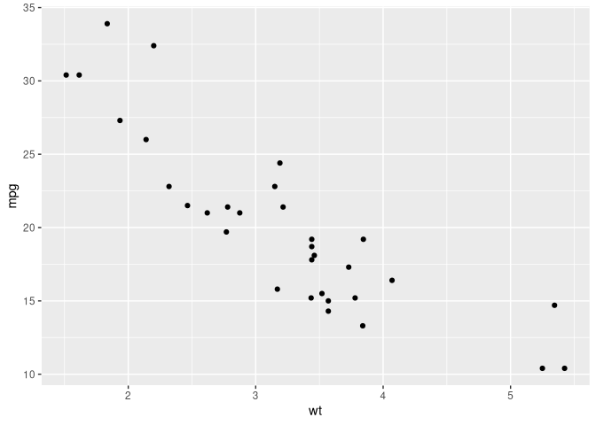

<!-- README.md is generated from README.Rmd. Please edit that file -->

# `{qnp}`

<!-- badges: start -->

[](https://lifecycle.r-lib.org/articles/stages.html#experimental)
[](https://github.com/Morrison-Lab/qnp/actions)
[](https://app.codecov.io/gh/Morrison-Lab/qnp)
[](https://cran.r-project.org/web/licenses/MIT)

<!-- badges: end -->

The goal of `{qnp}` (“quarto-notes plots”) is to provide helpers for
including plots in Quarto notes. It currently provides one function,
`interactive_plot()`, which makes a `{ggplot2}` plot interactive in HTML
output and leaves it unchanged in other output formats.

## Installation

You can install the development version of `{qnp}` from
[GitHub](https://github.com/) with:

``` r
# install.packages("pak")
pak::pak("Morrison-Lab/qnp")
```

## Example

`interactive_plot()` takes a `ggplot` and a text alternative (`alt`) for
the plot:

``` r
library(ggplot2)
library(qnp)

p <- ggplot(mtcars, aes(wt, mpg)) +
  geom_point()

interactive_plot(
  plot = p,
  alt = "Scatterplot of fuel economy versus car weight",
  is_html = FALSE
)
```



In HTML output (the default, via `is_html = knitr::is_html_output()`),
the result is an interactive [plotly](https://plotly.com/r/) widget
wrapped in a `<div>` with `role = "img"` and `aria-label = alt`, so that
screen readers announce it as a single image. In other output formats,
the original `ggplot` is returned unchanged. This README is rendered to
GitHub-flavored Markdown, which knitr counts as an HTML output format,
so the example sets `is_html = FALSE` explicitly to show the static
plot.

See [USAGE.md](USAGE.md) for more details.

## Development

### Building the Documentation Site

This package uses [altdoc](https://altdoc.etiennebacher.com/) with
[Quarto](https://quarto.org/) to build its documentation site. To build
and preview the documentation locally:

``` r
# Load the package
pkgload::load_all()

# Render the documentation
altdoc::render_docs()

# Preview the site
altdoc::preview_docs()
```

The documentation is automatically built and deployed to GitHub Pages
via GitHub Actions when changes are pushed to the main branch.

## Why a separate repository

`{qnp}` is an R package, and the notes sites that use it are Quarto websites, so the two live in separate repositories.
The decision and its reasons are in the lab's [repository-template guidance](https://github.com/Morrison-Lab/ai-config/blob/main/shared/workflow/repo-templates.md#keep-an-r-package-and-a-notes-site-in-separate-repositories).
The notes on choosing colors are in the [visualization notes](https://morrison-lab.github.io/vds/).

## Code of Conduct

Please note that the `{qnp}` project is released with a [Contributor
Code of
Conduct](https://contributor-covenant.org/version/2/1/CODE_OF_CONDUCT.html).
By contributing to this project, you agree to abide by its terms.
